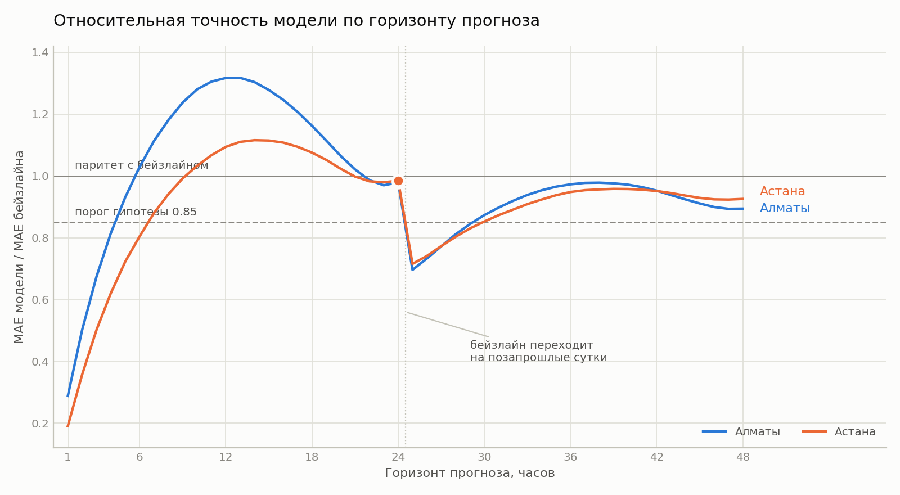
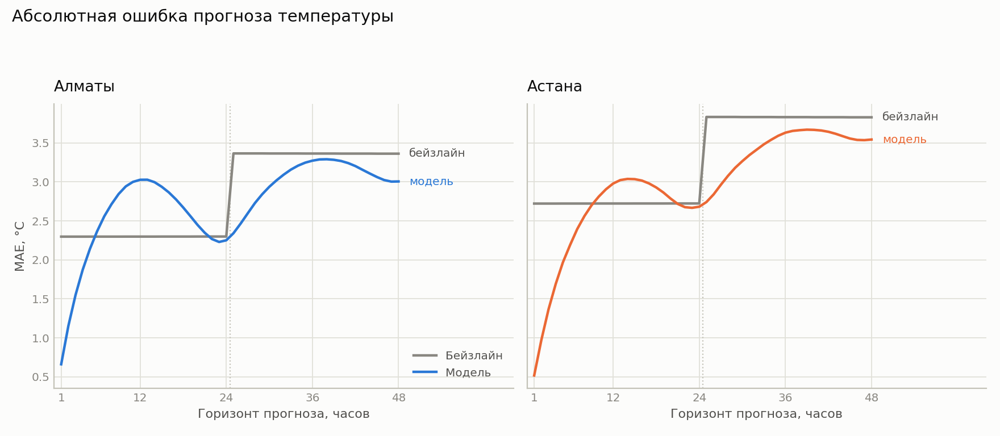
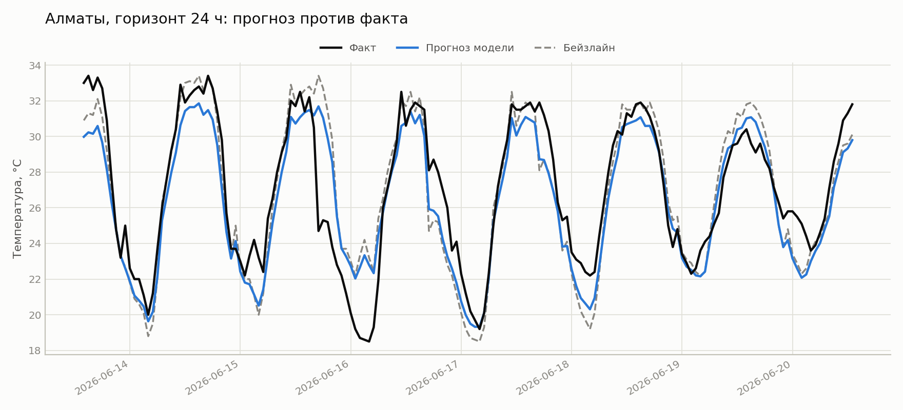

# Результаты оценки моделей

Спринт 4, замер от 13.10.2026. Скрипты `scripts/models.py` и `scripts/plot_results.py`.

## Условия эксперимента

| Параметр | Значение |
|---|---|
| Период данных | 2023-10-01 .. 2026-10-01 |
| Объём ряда | 26 328 наблюдений на город |
| После формирования признаков | 26 232 строки |
| Обучающая выборка | 20 962 строки (80 %) |
| Тестовая выборка | 5 247 строк (20 %) |
| Разбиение | Хронологическое, с зазором 24 часа |
| Города | Алматы, Астана |
| Горизонты | От 1 до 48 часов |

Признаки: `lag_0`, `lag_1`, `lag_24`, `lag_48` (значения температуры со смещением назад на указанное число часов), `hour_sin`, `hour_cos`, `doy_sin`, `doy_cos` (циклические представления часа суток и дня года).

Бейзлайн: сезонный наивный прогноз. Значение в целевой момент принимается равным значению того же часа суток ближайшего доступного дня.

Модель: множественная линейная регрессия, обучается отдельно на каждый горизонт.

## Результаты на ключевых горизонтах

**Алматы**

| Горизонт | MAE бейзлайн | MAE модель | MAE ratio | RMSE бейзлайн | RMSE модель | RMSE ratio |
|---|---|---|---|---|---|---|
| 1 ч | 2.298 | 0.662 | 0.288 | 3.180 | 0.907 | 0.285 |
| 6 ч | 2.298 | 2.366 | 1.029 | 3.181 | 3.013 | 0.947 |
| 12 ч | 2.299 | 3.027 | 1.317 | 3.181 | 3.740 | 1.176 |
| 24 ч | 2.299 | 2.251 | 0.979 | 3.182 | 2.985 | 0.938 |
| 48 ч | 3.362 | 3.006 | 0.894 | 4.458 | 3.885 | 0.871 |

**Астана**

| Горизонт | MAE бейзлайн | MAE модель | MAE ratio | RMSE бейзлайн | RMSE модель | RMSE ratio |
|---|---|---|---|---|---|---|
| 1 ч | 2.722 | 0.518 | 0.190 | 3.725 | 0.768 | 0.206 |
| 6 ч | 2.723 | 2.190 | 0.804 | 3.726 | 2.907 | 0.780 |
| 12 ч | 2.723 | 2.979 | 1.094 | 3.726 | 3.778 | 1.014 |
| 24 ч | 2.723 | 2.682 | 0.985 | 3.727 | 3.506 | 0.941 |
| 48 ч | 3.828 | 3.543 | 0.926 | 5.088 | 4.547 | 0.894 |

Колонка ratio содержит отношение ошибки модели к ошибке бейзлайна. Значение меньше единицы означает выигрыш модели, больше единицы - проигрыш.

## Проверка рабочей гипотезы

Формулировка из Research Memo: линейная регрессия на лаговых признаках, обученная не менее чем на трёх годах часовых наблюдений, снижает среднюю абсолютную ошибку прогноза температуры на горизонте 24 часа не менее чем на 15 % относительно сезонного наивного прогноза на отложенной тестовой выборке.

Пороговое значение MAE ratio для подтверждения: не выше 0.85.

| Город | MAE ratio на 24 ч | Фактическое снижение | Вывод |
|---|---|---|---|
| Алматы | 0.979 | 2.1 % | Не подтверждена |
| Астана | 0.985 | 1.5 % | Не подтверждена |

**Гипотеза не подтвердилась.** Модель превосходит бейзлайн, но величина превосходства на порядок меньше заявленного порога.

Отрицательный результат зафиксирован в соответствии с условием, записанным в Research Memo: расхождение модели с бейзлайном менее чем на 15 % считается опровержением гипотезы, и этот исход признаётся результатом эксперимента.

## Зависимость точности от горизонта

Расчёт выполнен для всех горизонтов от 1 до 48 часов. Кривая немонотонна и имеет три характерных участка.

**Горизонты 1-4 часа.** Модель существенно превосходит бейзлайн: снижение ошибки достигает 71 % по Алматы и 81 % по Астане. На коротких горизонтах текущее значение температуры почти совпадает с целевым, и модель использует его напрямую.

**Горизонты 5-22 часа.** Модель уступает бейзлайну, максимум проигрыша приходится на 12-14 часов. Объяснение приведено ниже.

**Горизонты 23-48 часов.** Модель возвращается в область выигрыша, но порог гипотезы не преодолевает ни на одном горизонте.

## Разрыв кривой на 24 часах

На кривой отношения наблюдается разрыв между горизонтами 24 и 25 часов: значение падает с 0.98 до 0.70. Разрыв не связан с поведением модели.

Из графика абсолютных ошибок видно, что ошибка бейзлайна представляет собой ступенчатую функцию: 2.30 °C для Алматы на всех горизонтах от 1 до 24 часов и 3.36 °C на горизонтах от 25 до 48 часов.

Причина заложена в определении сезонного наивного прогноза. До 24 часов включительно он опирается на значение, отстоящее от целевого момента ровно на сутки, вследствие чего ошибка одинакова на всём этом диапазоне. Начиная с 25 часов ближайший доступный день смещается на сутки назад, расстояние до целевого момента возрастает до двух суток, и ошибка скачкообразно увеличивается.

Ошибка модели при этом изменяется непрерывно. Таким образом, разрыв на кривой отношения отражает ступенчатое изменение знаменателя, а не свойства числителя.

## Анализ результатов

### Расхождение между MAE и RMSE

На горизонте 24 часа отношение по MAE составляет 0.979, по RMSE - 0.938. Выигрыш по RMSE втрое заметнее.

Расхождение закономерно. Метод наименьших квадратов, лежащий в основе линейной регрессии, минимизирует сумму квадратов отклонений, то есть оптимизирует именно RMSE. Для сокращения крупных промахов модель сжимает прогнозы к среднему значению. Это подтверждается коэффициентом при `lag_0`, равным 0.662 вместо ожидаемой единицы: модель систематически занижает амплитуду прогноза. Крупные ошибки сокращаются, но возрастает число мелких, из-за чего MAE улучшается слабее RMSE.

Следствие для постановки задачи: формулировка гипотезы через MAE оказалась не согласованной с методом обучения. При формулировке через RMSE результат был бы ближе к порогу, хотя и не достиг бы его.

### Зависимость качества от фазы суточного цикла

Форма кривой объясняется взаимным расположением признаков и цели в суточном цикле.

| Горизонт | Фаза цели относительно `lag_0` | MAE ratio (Алматы) |
|---|---|---|
| 1 ч | Совпадает | 0.288 |
| 6 ч | Смещена на четверть цикла | 1.029 |
| 12 ч | Противофаза | 1.317 |
| 24 ч | Совпадает | 0.979 |
| 48 ч | Совпадает | 0.894 |

Наиболее информативный признак модели - текущая температура `lag_0`. На горизонте 12 часов целевое значение приходится на противоположную точку суточного цикла: если текущий момент - полдень, то цель - полночь. Текущая температура в этом случае слабо связана с целью, и модель вынуждена опираться на поправку по часу суток.

Бейзлайн в той же ситуации сравнивает значения одного часа суток, отстоящие на сутки, то есть находится в выгодном положении. Этим объясняется проигрыш модели на средних горизонтах.

На горизонтах 24 и 48 часов цель снова приходится на тот же час суток, фаза совпадает, и модель восстанавливает преимущество.

### Ограничение линейной модели

Линейная регрессия складывает вклады признаков, но не образует их произведений. Модель способна выучить постоянную поправку, зависящую от часа суток, однако не способна выучить зависимость амплитуды суточного хода от сезона: летом суточная амплитуда существенно выше зимней.

Для выражения такой зависимости требуются признаки-произведения, например `lag_0 * hour_sin` или `lag_0 * doy_cos`. В текущем наборе признаков они отсутствуют.

### Коэффициенты модели

Алматы, горизонт 24 часа:

| Признак | Коэффициент |
|---|---|
| `lag_0` | 0.6623 |
| `lag_1` | 0.0498 |
| `lag_24` | -0.0528 |
| `lag_48` | 0.0568 |
| `hour_sin` | -0.5811 |
| `hour_cos` | -0.8552 |
| `doy_sin` | -0.8322 |
| `doy_cos` | -4.2606 |
| Свободный член | 3.2473 |

Основная нагрузка приходится на `lag_0` и `doy_cos`. Коэффициенты при `lag_24` и `lag_48` близки к нулю, то есть модель практически не использует значения суточной и двухсуточной давности при наличии текущего значения.

Сумма коэффициентов при лаговых признаках составляет 0.716, что количественно подтверждает эффект сжатия прогноза к среднему, описанный выше.

## Поведение прогноза на тестовой выборке

На отрезке тестовой выборки видно, что обе модели воспроизводят суточный ход температуры. Прогноз регрессии систематически занижает амплитуду: пики оказываются ниже фактических, впадины выше. Это визуальное подтверждение эффекта сжатия к среднему, выявленного по коэффициентам.

Бейзлайн амплитуду сохраняет, но смещён по фазе в случаях, когда суточный ход меняется от дня ко дню.

## Сопоставление городов

Абсолютная ошибка бейзлайна в Астане выше, чем в Алматы: 2.723 против 2.299 градуса на горизонте 24 часа. Разница согласуется с климатическими особенностями: резко континентальный климат Астаны обеспечивает большую изменчивость температуры, вследствие чего повторение вчерашнего значения оказывается менее точным.

При этом относительный выигрыш модели на коротком горизонте в Астане выше: 0.190 против 0.288. Более изменчивый ряд оставляет больше пространства для улучшения относительно тривиального прогноза.

## Проверка корректности реализации

Вычислительное ядро покрыто 24 модульными тестами (`tests/`), выполняемыми без обращения к базе данных на искусственных выборках с заранее известным результатом.

Отдельного внимания заслуживает тест `test_exact_on_perfectly_periodic_series`: на ряде с идеальным суточным циклом сезонный наивный прогноз обязан давать нулевую ошибку. Тест подтверждает корректность реализации бейзлайна независимо от реальных данных.

## Техническое замечание

При выполнении расчётов на платформе macOS библиотека линейной алгебры Accelerate, используемая numpy 2.0.2, выдаёт предупреждения о переполнении и делении на ноль в операции матричного умножения. Корректность результатов проверена независимо: предсказания sklearn сопоставлены с результатом прямого матричного умножения, расхождение составило 0.0. Предупреждения признаны ложными и подавлены.

## Выводы

1. Гипотеза в заявленной формулировке не подтверждена: снижение MAE на горизонте 24 часа составило 2.1 % и 1.5 % при требуемых 15 %.
2. Модель существенно превосходит бейзлайн на горизонте 1 час: снижение ошибки на 71 % и 81 %.
3. Модель уступает бейзлайну на средних горизонтах с максимумом проигрыша около 12-14 часов, что объясняется противофазным расположением признаков и цели в суточном цикле.
4. По метрике RMSE модель превосходит бейзлайн на большинстве горизонтов.
5. Кривая зависимости ошибки от горизонта немонотонна, её форма определяется фазой суточного цикла, а не исключительно удалённостью прогноза.
6. Разрыв кривой отношения на 24 часах вызван ступенчатым изменением ошибки бейзлайна при переходе на опорное значение позапрошлых суток, а не поведением модели.

## Направления дальнейшей работы

- Введение признаков-произведений для учёта зависимости суточной амплитуды от сезона.
- Добавление лага 168 часов (тот же час того же дня недели).
- Рассмотрение отдельной модели для каждого часа суток.
- Уточнение целевой метрики гипотезы: переход на RMSE как метрику, согласованную с методом обучения.
